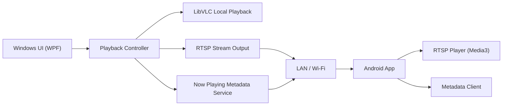

# Navrh: Windows 11 hudobny prehravac + LAN stream + Android klient

## Ciel

Program ma fungovat ako jednoduchy desktop prehravac na Windows 11 v style Winamp:

- prehrava MP3, FLAC, AAC, OGG, WAV a podobne formaty
- pri prehravani automaticky streamuje zvuk do lokalnej siete
- Android aplikacia sa po spusteni automaticky pripoji na dostupny stream
- latencia ma byt co najnizsia v ramci beznej domacej Wi-Fi siete
- Windows aplikacia sa da minimalizovat do system tray
- Windows aplikacia sa vie spustit po starte PC
- Android klient je velmi jednoduchy: prehrat stream, ukazat nazov skladby a interpreta

## Odporucena architektura

Najlepsia kombinacia pre tento projekt je:

- Windows desktop: `C# + .NET 8 + WPF`
- Audio engine na Windows: `LibVLCSharp`
- Tray ikona: `H.NotifyIcon.Wpf`
- Auto-discovery v sieti: `mDNS / Zeroconf`
- Metadata API: `lokalny HTTP endpoint v aplikacii`
- Android klient: `Kotlin + Media3 (ExoPlayer) + NsdManager`
- Stream protokol: `RTSP`, preferovane `UDP`, fallback `TCP`

Tato kombinacia je prakticka preto, ze:

- WPF je stabilne a vhodne na desktop utility pre Windows 11
- LibVLCSharp ma siroku podporu audio formatov
- RTSP dava podstatne nizsiu latenciu ako klasicky HTTP stream alebo HLS
- Android Media3 vie prehravat RTSP bez toho, aby bolo treba komplikovany klientsky stack
- mDNS umozni, aby Android appka nasla server automaticky bez rucneho zadavania IP

## Logicka architektura



## Ako to bude fungovat

### 1. Windows prehravanie

Windows aplikacia nacita lokalne subory alebo playlist.
Pouzivatel stlaci Play.
Audio engine:

- prehrava hudbu lokalne do reproduktorov/sluchadiel na PC
- zaroven z rovnakeho zdroja posiela stream do LAN

To znamena, ze netreba mat dva oddelene prehravace. Jeden playback pipeline obsluhuje:

- lokalny vystup
- sietovy vystup

### 2. LAN stream

Odporuceny stream:

- `rtsp://<nazov-pc-alebo-ip>:8554/music`

Odporuceny audio format v streame:

- `AAC-LC`, stereo, 44.1 kHz alebo 48 kHz, cca `128-192 kbps`

Alternativa pre este nizsiu latenciu:

- `Opus`

Prakticky kompromis pre prve MVP je vsak `AAC-LC`, lebo:

- je velmi kompatibilny
- jednoducho sa prehrava na Androide
- ma nizke CPU naroky

### 3. Auto-discovery

Windows appka bude v LAN publikovat mDNS sluzbu, napr:

- service type: `_musicstream._tcp.local`
- instance name: `MusicHost-PC`
- TXT record:
  - `path=/music`
  - `meta=http://host:8080/api/now-playing`
  - `name=Obyvacka`

Android appka pri spusteni:

- vyhlada `_musicstream._tcp.local`
- vyberie prvy alebo posledny uspesny server
- automaticky sa pripoji na RTSP stream

Ak sa server nenajde do napr. 5 sekund:

- zobrazi stav `Server nenajdeny`
- automaticky skusa reconnect pri zmene Wi-Fi siete alebo po kratkom intervale

### 4. Metadata skladby

Windows aplikacia bude drzat aktualne metadata:

- nazov skladby
- interpret
- album
- dlzka
- pozicia
- stav prehravania
- cover art volitelne

Metadata budu dostupne cez lahky lokalny endpoint:

- `GET /api/now-playing`

Priklad JSON:

```json
{
  "title": "Midnight City",
  "artist": "M83",
  "album": "Hurry Up, We're Dreaming",
  "durationMs": 244000,
  "positionMs": 81234,
  "state": "playing",
  "streamUrl": "rtsp://192.168.1.10:8554/music"
}
```

Android klient moze:

- bud pollovat kazde 2 sekundy
- alebo pouzit WebSocket / SSE

Pre prve MVP odporucam jednoduche polling API, lebo:

- je najlahsie na implementaciu
- na lokalnej sieti je zataz zanedbatelna
- netreba riesit reconnect logiku pre socket

## Odporucane moduly Windows aplikacie

### 1. `MusicPlayer.UI`

Zodpovednost:

- hlavne okno
- playlist
- play/pause/next/prev
- hlasitost
- zobrazenie aktualnej skladby

### 2. `MusicPlayer.Core`

Zodpovednost:

- playlist logika
- fronta skladieb
- metadata
- udalosti `NowPlayingChanged`, `PlaybackStateChanged`

### 3. `MusicPlayer.Audio`

Zodpovednost:

- integracia s LibVLCSharp
- lokalne prehravanie
- spustenie a zastavenie RTSP streamu

### 4. `MusicPlayer.Discovery`

Zodpovednost:

- mDNS publikovanie sluzby
- sprava hostname / IP / portov

### 5. `MusicPlayer.Api`

Zodpovednost:

- `GET /health`
- `GET /api/now-playing`
- volitelne `GET /api/playlist/current`

### 6. `MusicPlayer.Tray`

Zodpovednost:

- minimize to tray
- restore from tray
- tray menu: Play/Pause, Next, Quit

### 7. `MusicPlayer.Startup`

Zodpovednost:

- nastavenie `Start with Windows`
- registracia do `HKCU\\Software\\Microsoft\\Windows\\CurrentVersion\\Run`

## Odporucane moduly Android aplikacie

### 1. `discovery`

- hladanie servera cez `NsdManager`
- zapamatanie posledneho funkcneho hosta

### 2. `player`

- prehravanie `RTSP` cez `Media3 ExoPlayer`
- automaticky reconnect
- fallback z UDP na TCP

### 3. `metadata`

- citanie `GET /api/now-playing`
- jednoduchy refresh kazde 2 sekundy

### 4. `ui`

Jedna obrazovka:

- nazov skladby
- interpret
- stav pripojenia
- play indikator
- pripadne cover art

Pouzivatel nepotrebuje nic nastavovat. Po spusteni app:

- hlada server
- pripoji sa
- prehrava

## Nizka latencia

Ak je ciel minimalne oneskorenie, najdolezitejsie su tieto rozhodnutia:

1. Nepouzivat HLS ani DASH.
2. Nepouzivat klasicky HTTP MP3 stream ako hlavny rezim.
3. Pouzit RTSP s co najmensim bufferom na Android strane.
4. Preferovat UDP v ramci lokalnej siete.
5. Dat moznost prepnut na TCP fallback, ked je Wi-Fi nestabilna.

Realisticky ciel pre domacu siet:

- dobra Wi-Fi: cca `200-500 ms`
- konzervativnejsi rezim: cca `500-1200 ms`

Ak by bol ciel skoro real-time synchronizacia medzi miestnostami, potom by uz bolo vhodne zvazit:

- `WebRTC audio`
- alebo specializovany multiroom protokol

To je ale vyrazne komplikovanejsie ako tento projekt potrebuje.

## UI navrh Windows appky

Minimalne prvky:

- playlist panel
- hlavny riadok so skladbou a interpretom
- Play / Pause / Stop
- Previous / Next
- seek bar
- volume slider
- tlacidlo `Minimize to tray`
- checkbox `Start with Windows`
- status `Streaming: ON`
- IP alebo host `rtsp://...`

Spravanie:

- zatvorenie okna nemusi ukoncit appku, iba ju skryje do tray
- skutocne ukoncenie bude cez tray menu `Quit`

## UI navrh Android appky

Jedna velmi jednoducha obrazovka:

- velky nazov skladby
- mensi text interpret
- stav:
  - `Pripajam...`
  - `Pripojene`
  - `Server nenajdeny`
- male tlacidlo `Reconnect`

Volitelne:

- zobrazenie cover art
- mini indikacia bitrate alebo latencie

## MVP rozsah

Prva verzia by mala obsahovat:

- lokalne prehravanie MP3/FLAC/AAC/OGG/WAV na Windows
- playlist z lokalneho priecinka
- RTSP stream do LAN
- mDNS discovery
- Android auto-connect
- zobrazenie skladby a interpreta na Androide
- tray rezim
- auto-start po starte Windows

Nemusi zatial obsahovat:

- vzdialene ovladanie z Androidu
- multiroom sync do viacerych zariadeni naraz s presnou synchronizaciou
- equalizer
- cover art cache
- editaciu tagov

## Faza 2

Dalsie vhodne rozsirena:

- ovladanie prehravania z Androidu
- oblubene playlisty
- fronta skladieb
- vyhladavanie
- album art
- Bluetooth headset controls na Androide
- automaticke obnovenie po vypadku siete

## Odporucany postup implementacie

### Faza A - Windows prototyp

- vytvorit WPF app
- rozbehat LibVLCSharp lokalne prehravanie
- pridat playlist
- overit system tray

### Faza B - Stream

- z jedneho playback pipeline pustit RTSP stream
- zmerat latenciu v LAN
- overit spravanie pri zmene skladby

### Faza C - Discovery a metadata

- pridat mDNS
- spristupnit `GET /api/now-playing`

### Faza D - Android klient

- jednoduchy Kotlin app
- auto-discovery
- RTSP playback
- metadata refresh

### Faza E - Dokoncenie UX

- autostart
- reconnect logika
- fallback TCP/UDP
- osetrenie chyb

## Preco toto odporucam

Tento navrh drzi projekt jednoduchy, ale stale dostatocne kvalitny:

- nie je to prehnane komplikovane
- funguje dobre v domacej sieti
- vie dosiahnut nizku latenciu
- Android klient moze ostat velmi maly a jednoduchy
- Windows appka sa sprava presne ako rezidentny prehravac v style Winamp

## Odporucenie

Ak chces ist do implementacie, odporucam zacat tymto stackom:

- Windows: `WPF + LibVLCSharp + H.NotifyIcon.Wpf`
- Android: `Kotlin + Media3`
- Discovery: `mDNS / Zeroconf`
- Metadata: `HTTP JSON`
- Stream: `RTSP (UDP first, TCP fallback)`

To je najlepsia rovnovaha medzi:

- rychlostou vyvoja
- kompatibilitou
- jednoduchostou Android klienta
- nizkou latenciou

## Doplnenie: perzistentny playlist a historia

Aplikacia nema po restarte prist o zoznam skladieb. Preto ma MVP obsahovat:

- automaticke ulozenie aktualneho playlistu na disk
- ulozenie poslednej vybranej skladby a pozicie v nej
- historiu naposledy prehranych skladieb
- obnovu playlistu po dalsom spusteni aplikacie

Odporucane ulozisko:

- `%APPDATA%\\LanMusicPlayer\\state.json`

## Doplnenie: vypnutie PC po poslednej skladbe

Toto je vhodne zaradit ako `krok 2`, nie ako uplne prvu nutnost. Implementacia bude jednoducha:

- checkbox `Vypnut PC po poslednej skladbe`
- po dohrati poslednej polozky playlistu aplikacia zavola Windows shutdown
- predvolene bude tato volba vypnuta
