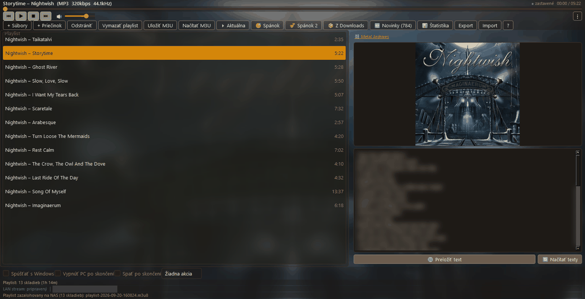
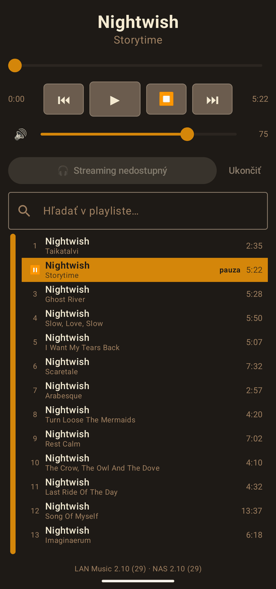

# hudba-lan — a music player for the whole flat

A Windows music player that streams whatever it is playing to the local
network, and an Android app that finds it by itself, plays the stream and works
as a remote control — including a home-screen widget that can put the PC to
sleep when I do.

It started as "I want to hear the music from the laptop in the kitchen" and
grew from there. It is the biggest thing I have built: about 8 000 lines of
Python, 4 000 lines of Kotlin, ~220 Python tests and ~40 on the Android side.

Python · PySide6 · ffmpeg · Kotlin · Jetpack Compose · LibVLC

## What it looks like



The PC player. The row above the playlist is most of the app in one line: two
*sleep* playlists, the importer that unpacks a downloaded album and renames it,
the weekly new-releases list, and the statistics. On the right, the cover and
the *Metal Archives* link above it are what the player found for this album on
its own — the same lookup that renames the folder. Under the cover are the
lyrics, blurred here on purpose: they are someone else's writing and this is a
public page. In the app they are readable, and the button below them sends
them to DeepL and keeps the translation on disk next to the track, so the same
song costs the quota once. The line at the bottom says whether the LAN stream
is up — the address next to it is blanked out, it is a real address on my home
network.



The phone, showing the same playlist the PC has, with the current track marked.
*Streaming nedostupný* is honest: nothing is playing at that moment, so ffmpeg
is not running and there is no stream to join. This shot was taken in an
emulator, where a UDP broadcast from the PC never arrives, so the player was
reached through the manual address the settings offer for exactly that case —
on a phone on the same Wi-Fi the discovery finds it without typing anything.

The interface is Slovak.

## The pieces

```
 Windows PC                                     Android phone
 ┌──────────────────────────────┐               ┌──────────────────────────┐
 │ PySide6 player (QMediaPlayer)│  UDP beacon   │ finds the player by      │
 │                              │ ────────────► │ itself, no IP typing     │
 │ ffmpeg → multicast stream    │  audio stream │ LibVLC plays the stream  │
 │                              │ ────────────► │                          │
 │ HTTP API :8765               │ ◄──────────── │ remote control + widget  │
 │  now-playing, play/pause,    │  commands     │  (sleep / shut down PC)  │
 │  sleep, health, version      │               │                          │
 └──────────────────────────────┘               └──────────────────────────┘
```

- **Player** — playlist, history, tray icon, autostart, media keys.
- **Stream** — ffmpeg starts on *Play* and stops on *Pause*, low-latency
  multicast to the LAN.
- **Discovery** — the PC broadcasts a small UDP beacon every 2 seconds with the
  API port, so the phone never needs an IP address typed in.
- **Remote** — the phone shows what is playing and controls the player; the
  widget has four buttons for the evening: start one of two "falling asleep"
  playlists, put the PC to sleep, or shut it down — each behind a confirmation.
  It also has a volume strip, which is not a slider: `RemoteViews` has no
  `SeekBar`, and a drag across a widget belongs to the launcher, not to the
  app. So the strip is a `ProgressBar` with twenty invisible tiles over it,
  each carrying its own "set volume to 5 / 10 / … / 100 %" — and each needing
  its own PendingIntent request code, because two PendingIntents that differ
  only in an extra are the same intent to Android.
- **Self-update** — both the PC app and the Android app update themselves from
  my NAS. The PC checks only a few hundred bytes of `latest.json`, asks, then
  downloads the package, verifies its SHA-256, replaces itself and restarts.
  User files (`config.txt`, sleep playlists) are never overwritten.

## The part I like most: album names

Downloaded albums arrive named every possible way —
``Dark Plague`2026`Masquerade by necroscum``, `Blind-Guardian-Somewhere-2026-GRP`.
Before unpacking, the folder is renamed to `Artist - Album - Year` in three
steps, each more expensive than the one before:

1. **Offline rules** (`nazvy.py`) — split on backticks, dashes, underscores,
   pull out the year, drop `[FLAC]`, `(WEB)` and release-group tags. If the
   result is unambiguous, done.
2. **The weekly new-releases list** that is already on disk.
3. **Metal Archives** (`nazvy_ma.py`) — searched **only by band name**, from the
   longest possible name to the shortest; the album is then matched offline
   against the discography.

```
Blind-Guardian-Somewhere-2026-GRP
  -> band "Blind Guardian Somewhere"?  MA: nothing
  -> band "Blind Guardian"?            MA: discography
  -> an album whose words are all in the folder name? no -> keep original
```

**If nothing matches, the name stays as it came.** A wrongly guessed artist is
worse than the original mess — the mess can at least be read and fixed by hand.
Metal Archives also knows the proper spelling, so `Behemoth-I-Scvlptor` ends up
as `Behemoth - I, Scvlptor`.

## Two laptops, one list

A nightly job on another machine writes new metal releases to the NAS; the
player shows them under *Novinky* and I tick off what I have heard — on either
of two laptops. One shared file would have the laptops overwrite each other,
so there are two: the list (written only by the job) and an **append-only**
log of ticks, one JSON line per click. Two writes at once have nothing to fight
over, the last line about an album wins, and a tick can be undone.

## Things that broke in real life

- **After waking up, the phone could not reach the player.** The beacon is
  outgoing UDP and always gets through, but the API is incoming. When Windows
  decides after an IP change that this is a *new* network, it marks it Public
  and the firewall rule made for the Private one no longer applies.
  `oprava-lan-pristupu.cmd` fixes the profile and makes the rules `profile=any`.
- **"Autostart" does not start after sleep.** The `Run` key fires on login,
  and waking up is not a login. A scheduled task on the wake event fixes it.
- **Self-update was silent in two different situations** — NAS unreachable
  (normal, you are away) and NAS reachable but the share refusing the
  credentials (the app will never update again). They looked the same; now the
  second one says so, and the first one retries after 1, 5 and 15 minutes.

## Run

```
python -m pip install PySide6 mutagen requests
python app.pyw
```

Tests: `python -m pytest -q tests` (PC) and `./gradlew testDebugUnitTest` in
`android/`.

Lyrics translation uses the DeepL API. No key is included in this repository —
create your own free key at https://www.deepl.com/pro-api and put it in
`config.txt` as `DEEPL_API_KEY=...`. Without a key the player works, only the
translation is off.

The UI is in Slovak. The original Slovak README, much longer and with every
setting explained, is in [README.sk.md](README.sk.md). Design notes from the
beginning are in [NAVRH_HUDBA_LAN.md](NAVRH_HUDBA_LAN.md).
